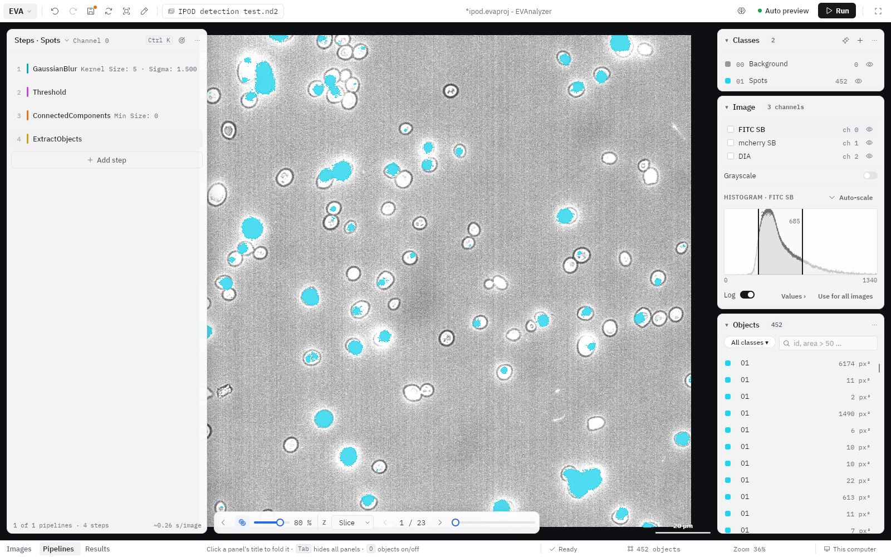

# EVAnalyzer
***Enhanced Visual Analyzer***

<div align="center">

[](https://evanalyzer.org)
[](https://forum.image.sc/tag/evanalyzer)
[](https://github.com/evanalyzer/evanalyzer/releases/latest)
[](https://github.com/evanalyzer/evanalyzer/releases)
[](https://github.com/evanalyzer/evanalyzer/actions/workflows/ci.yml)
[](https://evanalyzer.github.io/evanalyzer/)
[](#license)
[](https://github.com/evanalyzer/evanalyzer/releases/latest)

<a href="https://slint.dev"></a>

**Find, classify and measure objects in microscopy images - reproducibly, on ordinary computers.**



</div>

EVAnalyzer is a desktop application for bioimage analysis. You build a pipeline
of steps, tune it live on the image, and run it over thousands of images or
whole slides. Results go into one database you can explore, chart and export.

- **Reads microscopy and whole-slide formats directly** - CZI, ND2, LIF, VSI,
  OME-TIFF, SVS, NDPI, MRXS and more, with pyramids, z-stacks, time series and
  multi-well plates.
- **Pipelines you tune on the image** - filters, thresholds, watershed, AI
  segmentation (Cellpose-SAM, StarDist, U-Net), trained pixel and object
  classifiers; every change is previewed right away.
- **Measurements that match the reference tools** - intensity, shape, texture,
  colocalization, neighbors and parent/child relations, checked against
  CellProfiler and ImageJ.
- **Tracking and filaments** - follow objects over time (LAP, Kalman and
  overlap trackers) and trace filaments and neurite trees.
- **Results in one place** - tables, plate heat maps and charts; export to CSV,
  Excel and Parquet.
- **Runs where your data is** - on your computer, from the command line, or on
  a shared workstation or server that others log in to.

## Download

Get the latest version for Linux, Windows or macOS from the
[releases page](https://github.com/evanalyzer/evanalyzer/releases/latest).
Unpack the archive and start `evanalyzer` - everything it needs is included.
AI models run on a discrete GPU when there is one (only the normal graphics
driver is needed), else on the CPU.

**Checking a download.** Every file of a release comes with a provenance
attestation: proof that exactly this file was built by this repository's
release workflow from the tagged commit. With the
[GitHub CLI](https://cli.github.com/):

```sh
gh attestation verify evanalyzer-linux-x86_64.tar.gz -R evanalyzer/evanalyzer
gh attestation verify oci://joda001/evanalyzer:<version> -R evanalyzer/evanalyzer   # Docker image
```

Without it, compare the file's SHA-256 (`sha256sum`, on Windows
`certutil -hashfile <file> SHA256`) with `SHA256SUMS` on the release page.
The Windows programs are additionally signed (Authenticode).

## Where EVAnalyzer stores its data

**Your settings and templates** are in one folder in your home folder:

| System | Folder |
|---|---|
| Linux | `~/.evanalyzer/` |
| macOS | `~/evanalyzer/` |
| Windows | `C:\Users\<name>\evanalyzer\` |

```
evanalyzer/
├── settings.json      app settings, incl. the servers you trust
├── templates/         your templates and modules
└── logs/crash.log     details of crashes, for bug reports
```

Copy this folder to move your settings to another computer. When you work
on a server, the same folder is in your home folder on the server.

**A server** keeps everything it creates in its data folder - change it with
`--data-dir` or `data_dir` in the config file:

| Server runs | Data folder |
|---|---|
| as a system service (root, Linux) | `/var/lib/evanalyzer/` |
| as a normal user, Linux | `~/.evanalyzer/server/` |
| as a normal user, macOS / Windows | `~/evanalyzer/server/` |

```
<data folder>/
├── tls/               self-signed certificate and key - back it up, or
│                      clients have to trust a new fingerprint
├── sessions.json      the running workers
└── single-user/       home of the single user (default user setup)
```

Files you write yourself as the server admin are not in the data folder. The
server reads them from the path you give it, so you can keep them anywhere
(`/etc/evanalyzer/` is the usual place):

| File | Path given by |
|---|---|
| server config | `evanalyzer server --config /etc/evanalyzer/server.toml` |
| users file (optional) | `[users.file] path = "..."` in the server config |
| your own TLS certificate and key (optional) | `[tls] cert = "..."` and `key = "..."` in the server config |

See [docs/server.md](docs/server.md) for all settings.

## How results are grouped and summed up

- **Wells** come from the image name: the plate's grouping pattern (or an
  export's group regex), its first capture group. An image the pattern
  doesn't fit has no well: it is left out of well lines (time course,
  profile, charts) and is in the row "No group" of the rows per well.
- **Folders** come from the image's path below the image root. An image
  directly in the image root is in the folder `(root)`: its own row, time
  course line and split file part (`_root_`).
- **Statistics** (mean, SD, median, quartiles, min, max, sum, skewness)
  are taken over the objects that have the value. A value that can't be
  computed is stored empty, never as NaN or infinity. Results files
  analysed before 2026-11-25 can hold NaN in `minor_axis` and `min_feret`
  (and eccentricity 0 instead of 1) for objects that are a line of pixels:
  statistics over those columns fail there until the images are analysed
  again.

See [docs/exports.md](docs/exports.md) for the export file format.

## Documentation and help

- **User guide:** [evanalyzer.org](https://evanalyzer.org) - getting started,
  every pipeline step, the command line and running a server.
- **Questions:** ask on the [image.sc forum](https://forum.image.sc/tag/evanalyzer)
  with the tag `evanalyzer`.
- **Bugs and feature requests:** open an
  [issue](https://github.com/evanalyzer/evanalyzer/issues).

## How to cite

If you use EVAnalyzer in your research, please cite the software and the
methods of the steps you used:

1. **Write the methods text:** *Cite project* in the top bar (or
   `evanalyzer cli project cite --project my.evaproj`) writes a Markdown file with a
   ready-to-paste methods paragraph - EVAnalyzer with its version, then each
   pipeline's steps with their citations - and the full reference list.
2. **Cite EVAnalyzer itself:**

   > Danmayr, J. (2026). *EVAnalyzer: Enhanced Visual Analyzer.*
   > https://github.com/evanalyzer/evanalyzer

   GitHub's "Cite this repository" button gives it as BibTeX or APA (from
   [`CITATION.cff`](CITATION.cff)). A paper is in preparation; this section
   will name it once it is published.

---

## Development Setup

### Prerequisites

- **Rust** 1.95 or later (2024 edition): `rustup update`
- **Native libraries** (DuckDB on Windows/macOS; Linux compiles it), downloaded
  once into `libs/`:

  ```sh
  libs/download.sh win            # or win-arm64 | mac
  ```

- **Linux system libraries** for the GUI:

  ```sh
  apt-get install libinput10 libxkbcommon0 libxkbcommon-x11-0 libfontconfig1 libgbm1
  ```

### Workspace

| Crate | What it does |
|---|---|
| `evanalyzer_core` | Image reading ([scopeio](https://github.com/evanalyzer/scopeio)), algorithms, objects, pipeline execution |
| `evanalyzer_cfg` | Project files and settings, generated pipeline command types |
| `evanalyzer_app` | Shared project state, local and remote backends |
| `evanalyzer_gui` | Slint desktop GUI |
| `evanalyzer_cli` | Headless command line (`evanalyzer cli ...`) |
| `evanalyzer_server` | Multi-user server (`evanalyzer server`, see [docs/server.md](docs/server.md)) |
| `evanalyzer_nn` | AI models (U-Net, StarDist, Cellpose-SAM on [burn](https://burn.dev)), trained classifiers, GPU/CPU runtime |
| `evanalyzer_bin` | The `evanalyzer` binary: GUI, CLI or server |

### Building

```sh
cargo build                          # the app
cargo build --no-default-features    # without the desktop app (command line, server, worker)
cargo run -p evanalyzer_bin -- --project my.evaproj   # start the GUI with a project
```

Release builds per platform (aliases in `.cargo/config.toml`):

| Target | Command | Notes |
|---|---|---|
| Linux x86-64 | `cargo build-linux` | |
| Linux ARM64 | `cargo build-linux-arm` | cross-compiling needs an arm64 sysroot with fontconfig - release builds run on an ARM runner |
| Windows x86-64 / ARM64 | `cargo build-win` / `cargo build-win-arm` | cross-compiled with [`cargo-xwin`](https://github.com/rust-cross/cargo-xwin) |
| macOS Apple Silicon | `cargo build-mac` | native; set `DUCKDB_LIB_DIR`/`DUCKDB_INCLUDE_DIR` (see `libs/download.sh mac`) |

### AI models

The AI model steps (Cellpose-SAM, StarDist, U-Net) run on
[burn](https://burn.dev) in `evanalyzer_nn`, built into the program: on
discrete GPUs through wgpu (only the normal graphics driver, no CUDA), else
on the CPU (burn-flex). `--ai-devices` picks the devices, `--gpu-slots` the
parallel inferences per GPU. A GPU that fails an inference hands it to the
CPU.

Models are EVAnalyzer's own `.evanet` files - safetensors files with the
architecture and settings in `__metadata__` -, converted once by hand with the dev tools in `docs/`
(`convert_cellpose_sam.py`, `convert_stardist.py`,
`export_unet_weights.py` + the `convert_unet` example) - see
[docs/nn_burn_migration_plan.md](docs/nn_burn_migration_plan.md).

**Shipping.** The release pipeline (`.github/workflows/release.yml`)
builds and packages every platform; a tag (`v0.2.0` or `0.2.0`) publishes
a GitHub release, each platform's files added as soon as its build is done.
Pushing to the `pipeline_start` branch runs the same builds without a
release, and nothing is signed. On a tag the Windows exe is signed with the Certum certificate, only if the tag itself is signed
with the release key - see [Release tag signing](#release-tag-signing).
Package layout:

```text
evanalyzer(.exe)            the app
duckdb.dll / libduckdb.dylib  Windows / macOS only (Linux has DuckDB built in)
templates/                  project and module templates
```

macOS: `libduckdb.dylib` relinked to `@loader_path` and ad-hoc signed.

### Testing

```sh
cargo test
```

The tests on real models (`#[ignore]`d, release build) need the model files
in `tests/` (see `.gitignore`). Benchmarks and how to compare runs are in
[BENCHMARK.md](BENCHMARK.md).

### Adding a pipeline command

Pipeline commands (`Blur`, `Threshold`, `Cellpose`, ...) are declared once, in
`evanalyzer_core`, and generated everywhere else:

1. Write a plain struct in `crates/core/src/algos/<category>/<name>.rs`:

   ```rust
   #[derive(CommandsMeta)]
   #[cmdsmeta(category = "segment", display_name = "My Command")]
   pub struct MyCommand {
       #[cmdsmeta(min = 1, max = 100, step = 1, default = 10)]
       pub some_number: usize,

       /// Path to a trained model.
       #[cmdsmeta(file_extensions = "pt,pth")]
       pub model_path: PathBuf,
   }

   impl ImageAlgorithm for MyCommand {
       fn execute(&self, ctx: &mut PipelineContext, cache: &mut GlobalPipelineCache) -> Result<(), InternalErrors> {
           /* ... */
       }
       fn name(&self) -> &'static str { "My Command" }
       fn cite(&self) -> Vec<&'static CitationMetadata> { vec![/* the method's publication */] }
       fn execution_scope(&self) -> ExecutionScope { ExecutionScope::Tile }
   }
   ```

   `ExecutionScope::Tile` runs the command per tile; `WholeImage` gets the
   whole image at once. The optional trait methods (RAM per tile pixel,
   measurement outputs, ...) are documented on `ImageAlgorithm` in
   `crates/core/src/algos.rs`.

2. Build. `crates/cfg/build/pipeline_commands_generator.rs` finds every
   `#[derive(CommandsMeta)]` struct and regenerates
   `crates/cfg/src/settings/pipeline_command.rs`,
   `crates/cfg/src/settings/pipeline_command_settings.rs` and
   `crates/core/src/job/algos_from_config.rs` (all `// @generated`): the
   settings type, the `PipelineCommand` variant, the editor parameters and the
   conversion to `MyCommand`. Nothing to wire up by hand.

Field types bring their own UI and behavior:

- `PathBuf` - a file picker, stored relative to the project so projects can be
  moved. `file_extensions` only narrows the picker's filter: a string
  (`"pt,pth"`) or a constant of `crates/cfg/src/file_extensions.rs`
  (`NN_MODEL_EXTENSION`).
- `ObjectClass` / `SegmentationClass` (also in `Vec`/`Option`) - a class
  picker, and listed in `PipelineCommand::object_classes()`. A trained model's
  own class ids use `ModelClass` / `ModelSegmentationClass` instead.
- `#[cmdsmeta(section = "Detection")]` groups settings under a header on the
  step card and on a page of their own in the step's settings dialog.

All field keys (`min`, `max`, `step`, `default`, `unit`, `regex`, `optional`,
`visibility`, `file_extensions`, `section`) are documented on
`commands_meta_derive` in `crates/core/macros/src/lib.rs`.

`PipelineCommand` variants are numbered alphabetically, so a new command
shifts the numbers of the ones after it. Run
`cargo test -p evanalyzer_cfg --test pipeline_command_coverage` and update
any number the test reports as shifted.

### File headers

Every source file starts with a license header. For Rust, the VS Code snippet
`comm-file-header-open` (`.vscode/comments.code-snippets`) writes it:

```rust
//! # my_file
//!
//! **Author:** Joachim Danmayr
//! **Date:** 2026-10-25
//!
//! ## License
//! Copyright 2026 Joachim Danmayr.
//! Licensed under the **PolyForm Noncommercial License 1.0.0**.
```

Files that `crates/cfg/build.rs` pulls in with `include!()` use `//` instead
of `//!`. Slint and Python files use a two-line comment:
`Copyright <year> Joachim Danmayr.` / `Licensed under the PolyForm
Noncommercial License 1.0.0.`

### Tools

```sh
rustup component add rustfmt
cargo install slint-lsp       # language server for .slint files
cargo install slint-viewer    # live preview of .slint files
```

To show the GUI from inside a dev container, allow X11 forwarding on the host
first: `xhost +local:docker`.

### Toolchain image

[.devcontainer/Dockerfile](.devcontainer/Dockerfile) is the image
`joda001/evanalyzer-toolchain`: the dev container and the CI/release jobs
build in it. Every tool in it is pinned to a version. Built for amd64 and
arm64 into one tag with Docker buildx (Docker Desktop has it; on Linux
`apt install docker-buildx-plugin`, or `docker-buildx` with the
distribution's Docker):

```sh
docker buildx create --name multi --use                           # once
docker run --privileged --rm tonistiigi/binfmt --install arm64    # once, x86 Linux without Docker Desktop only
docker buildx build --platform linux/amd64,linux/arm64 \
  -t joda001/evanalyzer-toolchain:<version> --push .devcontainer
docker buildx imagetools inspect joda001/evanalyzer-toolchain:<version>
```

On an x86 machine the arm64 half runs emulated (QEMU) and can take an hour
or more. The last command prints the image's `Digest:` (one for both
architectures). Put it in as `joda001/evanalyzer-toolchain:<version>@sha256:<digest>`
into `.devcontainer/devcontainer.json` and the workflows in
`.github/workflows/` - the digest, not only the tag: a tag can be moved to
another image, the digest can't, and the release signs with tools from
this image.

### Coverage, audit, SBOM and licenses

| What | Locally | In CI |
|---|---|---|
| Coverage | `cargo llvm-cov --html` (`cargo install cargo-llvm-cov`, `rustup component add llvm-tools-preview`) | `ci.yml` on `main` publishes the HTML report and badge to [GitHub Pages](https://evanalyzer.github.io/evanalyzer/); `release.yml` attaches `evanalyzer-<version>-coverage.lcov`, `-coverage-summary.txt` and `-coverage-html.zip` to every release |
| Dependency audit | `cargo audit` (`cargo install cargo-audit`) | `ci.yml` shows the result in the job summary; `release.yml` attaches `evanalyzer-<version>-audit.txt` and `.json` to every release; informational, not a gate |
| SBOM | `cargo cyclonedx --format json` (`cargo install cargo-cyclonedx`) | `release.yml` attaches `evanalyzer-<version>-sbom.cdx.json` to every release |
| Third-party licenses | see below | `ci.yml` (`licenses`) regenerates the list and fails if it differs from the committed one or a license isn't accepted; the test run fails if `THIRD-PARTY-NOTICES.txt` is out of date; `release.yml` puts `LICENSE` and `THIRD-PARTY-NOTICES.txt` into every archive |

After changing dependencies (adding or updating a crate, `cargo update`),
regenerate the license list and commit both files:

```sh
# 1. The About dialog's license list (all crates)
cargo about generate --locked --workspace \
  docs/about.hbs -o crates/gui/src/generated/third_party_licenses.json

# 2. THIRD-PARTY-NOTICES.txt, built from that list and
#    crates/gui/src/third_party_notices.json
UPDATE_NOTICES=1 cargo test -p evanalyzer_gui notices_file
```

cargo-about must be exactly 0.9.3 (`about.toml` works around a bug of that
version, and another version may format the output differently):
`cargo install cargo-about --locked --version 0.9.3 --features cli` - the
devcontainer image has it. What isn't a crate (code ported from other
projects, fonts, icons, native libraries such as DuckDB) is kept by hand in `crates/gui/src/third_party_notices.json`;
after editing it, only step 2 is needed.

`about.toml` lists the accepted licenses. Copyleft licenses are rejected unless
reviewed and listed per crate there.

### Licensing rules for contributors

EVAnalyzer is a clean-room implementation: no GPL/LGPL/AGPL code, and new
dependencies must be permissive (the only MPL-2.0 crates, `smartstring` via
`rhai`, `option-ext` via `dirs`, and `buildid` / `colored` via `burn`, are
reviewed per-crate exceptions).

- **Algorithms come from papers.** Implement a method from its publication and
  cite it (`CitationMetadata`); other tools may only serve as black boxes for
  reference values or as documentation of a file/model format. Never read or
  translate the code of GPL/AGPL projects (ImageJ's `AutoThresholder` is
  Landini's GPL plugin, not public-domain ImageJ 1 code; Ultralytics YOLO is
  AGPL; ilastik, QuPath, TrackMate and Fiji plugins are GPL).
- **Ports from permissive code** (BSD, MIT, Apache, public domain) are allowed:
  name the source in the file header and add its full license text to
  `crates/gui/src/third_party_notices.json` (then regenerate
  `THIRD-PARTY-NOTICES.txt`, see above).
- **Test data** needs a license that allows redistribution and commercial use,
  with its attribution in `crates/core/tests/README.md`. Not usable: BBBC035
  and other Cell Tracking Challenge data (copying forbidden, commercial use
  needs permission).

---

## Release tag signing

A release starts with a version tag (`v1.2.0` or `1.2.0`). The Windows exe
is signed with the Certum certificate (job `sign-windows`
in `.github/workflows/release.yml`) only when the tag is signed with the
release key - an SSH key on a YubiKey, kept apart from the key that signs
commits. A tag pushed with a stolen GitHub login alone signs nothing.

### Once: the release key

On the host (not in the dev container), with the YubiKey plugged in:

```sh
ssh-keygen -t ed25519-sk -C "evanalyzer release tags" -f ~/.ssh/evanalyzer-release
```

`~/.ssh/evanalyzer-release` is only a handle: without the YubiKey it signs
nothing. Then on GitHub:

- **Settings → SSH and GPG keys → New SSH key**, type *Signing Key*: the
  content of `evanalyzer-release.pub` (shows the tags as "Verified").
- **Repository → Settings → Environments → `release` → Variables**:
  `TAG_SIGNERS` = the content of `evanalyzer-release.pub` (one key per line;
  only these keys may start a signed release).

### Once: git

On the host. Both keys go in as text (`key::…`), not as a path, so git
finds them in the dev container too (VS Code copies `~/.gitconfig` in and
forwards the SSH agent with the private keys):

```sh
# commits: the github key, as text instead of a path
git config --global user.signingkey "key::$(cat ~/.ssh/github.pub)"

# release tags: the YubiKey key, as text
git config --global alias.release-tag \
  "tag -s -u 'key::$(cat ~/.ssh/evanalyzer-release.pub)'"
```

`gpg.format ssh` and `commit.gpgsign true` stay set as for signed commits.

### Every release

```sh
git release-tag v1.2.0 -m "v1.2.0"   # the YubiKey blinks: touch it
git push origin v1.2.0
```

Push the tag with git rather than creating the release on GitHub's web
page: the workflow creates the release itself, with the release notes.
The first job, `verify-tag`, checks that the tag is signed with a key in
`TAG_SIGNERS`, that the name inside the signed tag is the pushed one, and
that it points at the commit the run built. If not, nothing else runs: no
build, no GitHub release. `sign-windows` checks the same again right
before signing. Then delete the tag (`git push origin :refs/tags/v1.2.0`,
`git tag -d v1.2.0`) and tag again.

### On GitHub

- **Environment `release`**: holds `CERTUM_EMAIL`, `CERTUM_OTP` and
  `TAG_SIGNERS`; deployment tags `v*` and `[0-9]*` only, no branches.
  The Certum secrets are not repository secrets.
- **Tag ruleset** (Settings → Rules): tags `v*` and `[0-9]*` -
  creation, update and deletion restricted, only repository admins bypass.

A lost YubiKey: make a new key as above and replace it in `TAG_SIGNERS`
and in the GitHub signing keys. Existing releases stay valid.

---

## Contributing

Contributions are welcome. Please open an issue first for larger changes, so
we can agree on the direction. Then fork the repository, work on a branch and
open a pull request.

Before your first pull request can be merged, you need to accept the
[Contributor License Agreement](CLA.md). It transfers the rights in your
contribution to the maintainer, so EVAnalyzer can stay available under both
non-commercial and commercial licenses.

### Commit messages

Commit messages and pull request titles follow
[Conventional Commits](https://www.conventionalcommits.org/). The
`conventional-commits` workflow checks every pull request:

```
type(scope): description
```

- `scope` is optional, lowercase (`a-z`, `0-9`, `-`).
- The description starts right after `": "`, is at most 100 characters and
  doesn't end with a period.
- A `!` before the colon (`feat(cfg)!: ...`) marks a breaking change; explain
  it in a `BREAKING CHANGE:` footer.

| Type | Use it for |
|---|---|
| `feat` | A new feature or a new user-visible capability |
| `fix` | A bug fix, including results that were computed wrongly |
| `perf` | A speed or memory improvement without changing behavior |
| `refactor` | Restructured code without changing behavior or performance |
| `test` | New or changed tests only |
| `docs` | Documentation and comments only |
| `build` | Build system, Cargo features, dependencies (`build(deps)`) |
| `ci` | GitHub workflows and other CI configuration |
| `style` | Formatting or visual polish without changing behavior |
| `chore` | Maintenance that fits none of the above |
| `revert` | Reverting an earlier commit |

Common scopes are the crate or area a change is in: `core`, `gui`, `app`,
`cfg`, `ai`, `cli`, `server`, `results`, `viewport`, `deps`, `release`.

## License

EVAnalyzer is licensed under the
[PolyForm Noncommercial License 1.0.0](LICENSE): free for personal, academic,
research and other non-commercial use. Commercial use - in a company, in a
commercial product or service - needs a separate license; please
[open an issue](https://github.com/evanalyzer/evanalyzer/issues) or contact the
maintainer.

Third-party components keep their own licenses (listed in the About dialog
and in [THIRD-PARTY-NOTICES.txt](THIRD-PARTY-NOTICES.txt), which every release
archive carries next to `LICENSE`).
The image reader [scopeio](https://github.com/evanalyzer/scopeio) is AGPL-3.0
with an exception that lets it be distributed with EVAnalyzer under
EVAnalyzer's license.

## Acknowledgements

- [Slint](https://slint.dev/) - cross-platform UI toolkit
- [kornia-rs](https://github.com/kornia/kornia-rs) - computer vision primitives in Rust
- [DuckDB](https://duckdb.org/) - in-process analytical database
- [ImageJ](https://imagej.net/) and [CellProfiler](https://cellprofiler.org/) - algorithms ported to EVAnalyzer and reference values for its tests
