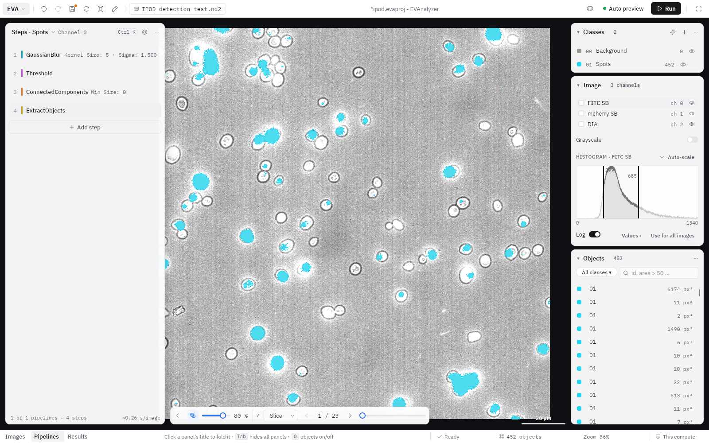

# EVAnalyzer
***Enhanced Visual Analyzer***

<div align="center">

[](https://evanalyzer.org)
[](https://forum.image.sc/tag/evanalyzer)
[](https://github.com/evanalyzer/evanalyzer/releases/latest)
[](https://github.com/evanalyzer/evanalyzer/releases)
[](https://github.com/evanalyzer/evanalyzer/actions/workflows/ci.yml)
[](docs/coverage-history.csv)
[](docs/audit-history.csv)
[](#license)
[](https://github.com/evanalyzer/evanalyzer/releases/latest)
<a href="https://slint.dev"></a>

**Find, classify and measure objects in microscopy images - reproducibly, on ordinary computers.**



</div>

EVAnalyzer is a desktop application for bioimage analysis. You build a pipeline
of steps, tune it live on the image, and run it over thousands of images or
whole slides. Results go into one database you can explore, chart and export.

- **Reads microscopy and whole-slide formats directly** - CZI, ND2, LIF, VSI,
  OME-TIFF, SVS, NDPI, MRXS and more, with pyramids, z-stacks, time series and
  multi-well plates.
- **Pipelines you tune on the image** - filters, thresholds, watershed, AI
  segmentation (Cellpose, StarDist, U-Net, YOLOv5), trained pixel and object
  classifiers; every change is previewed right away.
- **Measurements that match the reference tools** - intensity, shape, texture,
  colocalization, neighbours and parent/child relations, checked against
  CellProfiler and ImageJ.
- **Results in one place** - tables, plate heat maps and charts; export to CSV
  and Excel.
- **Runs where your data is** - on your computer, from the command line, or on
  a shared workstation or server that others log in to.

## Download

Get the latest version for Linux, Windows or macOS from the
[releases page](https://github.com/evanalyzer/evanalyzer/releases/latest).
Unpack the archive and start `evanalyzer` - everything it needs is included.
GPU (CUDA) builds for AI models are available for Linux and Windows.

## Documentation and help

- **User guide:** [evanalyzer.org](https://evanalyzer.org) - getting started,
  every pipeline step, the command line and running a server.
- **Questions:** ask on the [image.sc forum](https://forum.image.sc/tag/evanalyzer)
  with the tag `evanalyzer`.
- **Bugs and feature requests:** open an
  [issue](https://github.com/evanalyzer/evanalyzer/issues).

---

## Development Setup

### Prerequisites

- **Rust** 1.85 or later (2024 edition): `rustup update`
- **Native libraries** (libtorch for the AI plugin, DuckDB on Windows/macOS),
  downloaded once into `libs/`:

  ```sh
  libs/download.sh linux-cpu      # or linux-cuda | win-cpu | win-cuda | mac-cpu
  ```

- **Linux system libraries** for the GUI:

  ```sh
  apt-get install libinput10 libxkbcommon0 libxkbcommon-x11-0 libfontconfig1 libgbm1
  ```

### Workspace

| Crate | What it does |
|---|---|
| `evanalyzer_core` | Image reading ([scopeio](https://github.com/evanalyzer/scopeio)), algorithms, objects, pipeline execution |
| `evanalyzer_cfg` | Project files and settings, generated pipeline command types |
| `evanalyzer_app` | Shared project state, local and remote backends |
| `evanalyzer_gui` | Slint desktop GUI |
| `evanalyzer_cli` | Headless command line (`evanalyzer cli ...`) |
| `evanalyzer_server` | Multi-user server (`evanalyzer server`, see [docs/server.md](docs/server.md)) |
| `evanalyzer_ai_engine` | AI model interface and the libtorch plugin |
| `evanalyzer_bin` | The `evanalyzer` binary: GUI, CLI or server |

### Building

The app and the AI plugin are built separately - only the plugin links
libtorch:

```sh
cargo build                          # the app
cargo build-ai-plugin                # the libtorch plugin (alias in .cargo/config.toml)
cargo build --no-default-features    # the app without AI model support
cargo run -p evanalyzer_bin -- --project my.evaproj   # start the GUI with a project
```

A plugin next to the binary (as in `target/debug`) is found first;
`EVANALYZER_AI_PLUGIN=/path/to/libevanalyzer_ai_engine.so` points at another
one. Release packages put it in `ai/cpu` or `ai/cuda` with its libtorch (see
`.github/workflows/release.yml`).

Release builds per platform (aliases in `.cargo/config.toml`):

| Target | Command | Notes |
|---|---|---|
| Linux x86-64 | `cargo build-linux` | plugin: `cargo build-ai-plugin --release --target x86_64-unknown-linux-gnu` |
| Linux ARM64 | `cargo build-linux-arm` | `apt install gcc-aarch64-linux-gnu`, `rustup target add aarch64-unknown-linux-gnu` |
| Windows x86-64 / ARM64 | `cargo build-win` / `cargo build-win-arm` | cross-compiled with [`cargo-xwin`](https://github.com/rust-cross/cargo-xwin) |
| macOS Apple Silicon | `cargo build-mac` | native; set `DUCKDB_LIB_DIR`/`DUCKDB_INCLUDE_DIR` (see `libs/download.sh mac-cpu`) |

### Testing

```sh
cargo test                           # everything except the AI model steps
LD_LIBRARY_PATH=$PWD/libs/libtorch/lib \
  cargo test --features evanalyzer_core/libtorch,evanalyzer_core/libtorch-in-process
```

`libtorch-in-process` links libtorch into the test process for the AI model
steps' tests; `libtorch` adds the plugin loader, whose test builds and loads
the real plugin. Benchmarks and how to compare runs are in
[BENCHMARK.md](BENCHMARK.md).

### Adding a pipeline command

Pipeline commands (`Blur`, `Threshold`, `Cellpose`, ...) are declared once, in
`evanalyzer_core`, and generated everywhere else:

1. Write a plain struct in `crates/core/src/algos/<category>/<name>.rs`:

   ```rust
   #[derive(CommandsMeta)]
   #[cmdsmeta(category = "segment", display_name = "My Command")]
   pub struct MyCommand {
       #[cmdsmeta(min = 1, max = 100, step = 1, default = 10)]
       pub some_number: usize,

       /// Path to a trained model.
       #[cmdsmeta(file_extensions = "pt,pth")]
       pub model_path: PathBuf,
   }

   impl ImageAlgorithm for MyCommand {
       fn execute(&self, ctx: &mut PipelineContext, cache: &mut PipelineCache) -> Result<(), InternalErrors> {
           /* ... */
       }
       fn name(&self) -> &'static str { "MyCommand" }
   }
   ```

2. Build. `crates/cfg/build/pipeline_commands_generator.rs` finds every
   `#[derive(CommandsMeta)]` struct and regenerates
   `crates/cfg/src/settings/pipeline_command.rs`,
   `crates/cfg/src/settings/pipeline_command_settings.rs` and
   `crates/core/src/job/algos_from_config.rs` (all `// @generated`): the
   settings type, the `PipelineCommand` variant, the editor parameters and the
   conversion to `MyCommand`. Nothing to wire up by hand.

Field types bring their own UI and behaviour:

- `PathBuf` - a file picker, stored relative to the project so projects can be
  moved. `file_extensions` only narrows the picker's filter.
- `ObjectClass` / `SegmentationClass` (also in `Vec`/`Option`) - a class
  picker, and listed in `PipelineCommand::object_classes()`. A trained model's
  own class ids use `ModelClass` / `ModelSegmentationClass` instead.
- `#[cmdsmeta(section = "Detection")]` groups settings under a header on the
  step card and on a page of their own in the step's settings dialog.

All field keys (`min`, `max`, `step`, `default`, `unit`, `regex`, `optional`,
`visibility`, `file_extensions`, `section`) are documented on
`commands_meta_derive` in `crates/core/macros/src/lib.rs`.

`PipelineCommand` variants are numbered alphabetically, so a new command
shifts the numbers of the ones after it. Run
`cargo test -p evanalyzer_cfg --test pipeline_command_coverage` and update
any number the test reports as shifted.

### File headers

Every source file starts with a license header. For Rust, the VS Code snippet
`comm-file-header-open` (`.vscode/comments.code-snippets`) writes it:

```rust
//! # my_file
//!
//! **Author:** Joachim Danmayr
//! **Date:** 2026-10-25
//!
//! ## License
//! Copyright 2026 Joachim Danmayr.
//! Licensed under the **PolyForm Noncommercial License 1.0.0**.
```

Files that `crates/cfg/build.rs` pulls in with `include!()` use `//` instead
of `//!`. Slint and Python files use a two-line comment:
`Copyright <year> Joachim Danmayr.` / `Licensed under the PolyForm
Noncommercial License 1.0.0.`

### Tools

```sh
rustup component add rustfmt
cargo install slint-lsp       # language server for .slint files
cargo install slint-viewer    # live preview of .slint files
```

To show the GUI from inside a dev container, allow X11 forwarding on the host
first: `xhost +local:docker`.

### Coverage, audit, SBOM and licenses

| What | Locally | In CI |
|---|---|---|
| Coverage | `cargo llvm-cov --html` (`cargo install cargo-llvm-cov`, `rustup component add llvm-tools-preview`) | `ci.yml` on `main` updates `docs/coverage-badge.svg` and `docs/coverage-history.csv` |
| Dependency audit | `cargo audit` (`cargo install cargo-audit`) | `ci.yml` on `main` updates `docs/audit-badge.svg` and `docs/audit-history.csv`; informational, not a gate |
| SBOM | `cargo cyclonedx --format json` (`cargo install cargo-cyclonedx`) | `release.yml` attaches `evanalyzer-<version>-sbom.cdx.json` to every release |
| Third-party licenses | `cargo about generate docs/about.hbs -o crates/gui/src/generated/third_party_licenses.json` (`cargo install cargo-about --features cli`) | not regenerated by CI - run it and commit after changing dependencies |

`about.toml` lists the accepted licenses. Copyleft licenses are rejected unless
reviewed and listed per crate there.

---

## Contributing

Contributions are welcome. Please open an issue first for larger changes, so
we can agree on the direction. Then fork the repository, work on a branch and
open a pull request.

Before your first pull request can be merged, you need to accept the
[Contributor License Agreement](CLA.md). It transfers the rights in your
contribution to the maintainer, so EVAnalyzer can stay available under both
non-commercial and commercial licenses.

## License

EVAnalyzer is licensed under the
[PolyForm Noncommercial License 1.0.0](LICENSE): free for personal, academic,
research and other non-commercial use. Commercial use - in a company, in a
commercial product or service - needs a separate license; please
[open an issue](https://github.com/evanalyzer/evanalyzer/issues) or contact the
maintainer.

Third-party components keep their own licenses (listed in the About dialog).
The image reader [scopeio](https://github.com/evanalyzer/scopeio) is AGPL-3.0
with an exception that lets it be distributed with EVAnalyzer under
EVAnalyzer's license.

## Acknowledgements

- [Slint](https://slint.dev/) - cross-platform UI toolkit
- [kornia-rs](https://github.com/kornia/kornia-rs) - computer vision primitives in Rust
- [DuckDB](https://duckdb.org/) - in-process analytical database
- [ImageJ](https://imagej.net/) and [CellProfiler](https://cellprofiler.org/) - algorithms ported to EVAnalyzer and reference values for its tests
